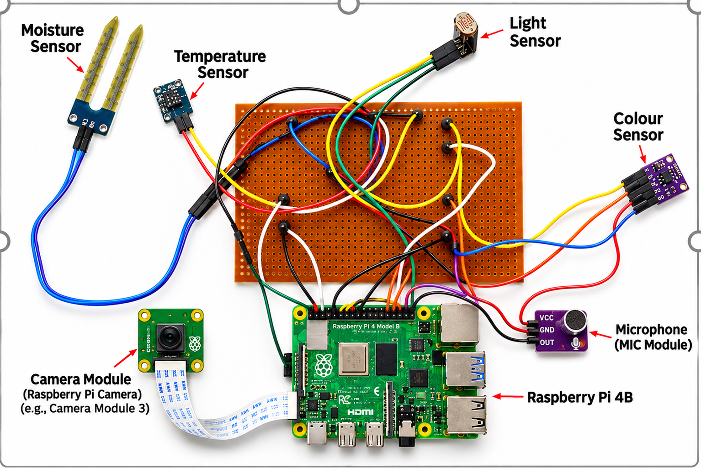
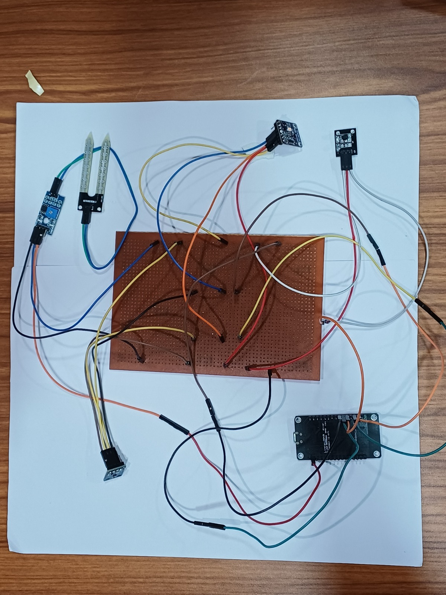
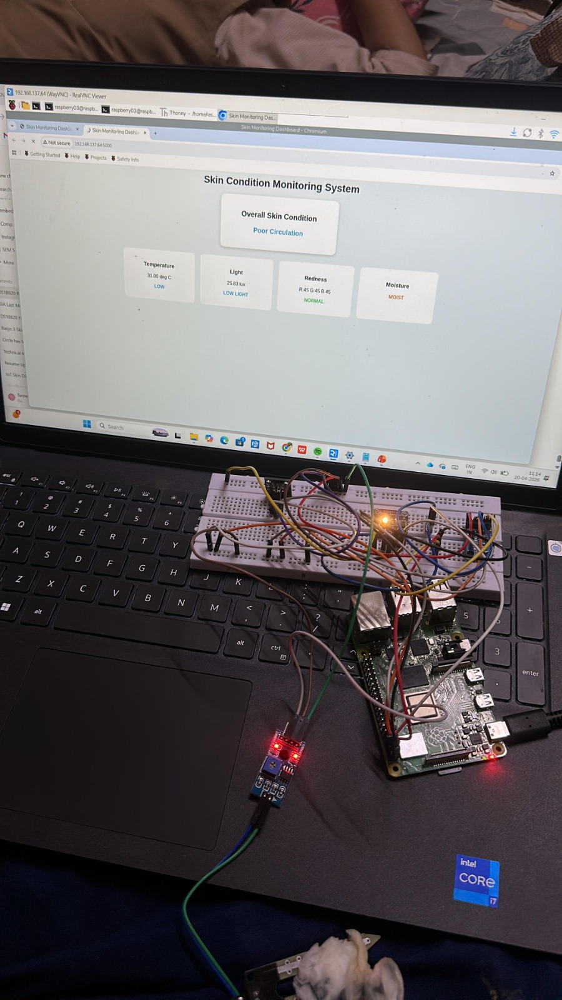

# SkinShield

**A multimodal edge-AI device for real-time skin disease triage in low-resource settings.**

`image + symptom text + IoT sensor data` → `on-device two-stage triage` → `referral guidance`

---

## Overview

SkinShield is a portable, Raspberry Pi-based IoT device that combines **three input modalities** — a dermatological photograph, a patient's written symptom description, and on-body sensor readings — to decide, on the device and without a cloud connection:

1. **Is this presentation potentially contagious?** If yes, the user is routed to medical care.
2. **If not, which condition is it most likely to be?** Drawn from a 388-condition dermatology ontology.

The system is built for the last mile: a primary health centre, a village clinic, or a field kit where no dermatologist is available.

<p align="center">
  
  <br>
  <em>Existing hardware prototype: Raspberry Pi 4B with a camera module, a microphone module and four skin/environment sensors - all three input modalities on one board</em>
</p>

---

## The problem

| Metric | Value | Source |
|---|---|---|
| People living with a skin condition | **2.0 billion** (25.7% prevalence, 6th most prevalent disease category) | GBD 2021 |
| Incident cases / deaths / DALYs | **4.69 B / 119,129 / 41.9 M** | GBD 2021 |
| Dermatologists in India | **fewer than 1 per 100,000** | JAMA Dermatology 2026 |
| Global / low-income density | **2.66 / 0.37 per 100,000** | JAMA Dermatology 2026 |
| Melanoma 5-year survival | **>99% localised → 76% regional → 35% distant** | American Cancer Society / SEER |
| India share of global leprosy | **~60%** | WHO |

The gap is not medical knowledge. It is reach.

---

## Three input modalities

SkinShield is deliberately **multimodal**. A single photograph is often ambiguous; a photograph plus the patient's own description plus objective skin measurements is substantially stronger.

| Modality | What it captures | How it is used |
|---|---|---|
| **Image** | Dermatological photograph of the lesion | Encoded by DermLIP's ViT-B-16 image tower → 512-d vector |
| **Text** | Patient-written symptom description | Encoded by DermLIP's text tower → 512-d vector |
| **IoT sensor data** | Skin temperature, moisture, light intensity, RGB colour | Normalised and fused with the image and text vectors |

### The sensor rig

The existing prototype is a **Raspberry Pi 4B** carrying a camera module, a microphone module and four sensors - all three input modalities on a single board.

| Sensor | Measures | Relevance |
|---|---|---|
| Temperature | Local skin/environment temperature | Inflammation, infection, circulation |
| Moisture | Surface hydration | Eczema, xerosis, barrier integrity |
| Light | Incident light intensity | UV exposure, lesion visibility |
| Colour (TCS34725 RGB) | Red / green / blue reflectance | Erythema, pigmentation, blanching |

Paired with those sensors on the same Pi:

| Module | Captures | Feeds |
|---|---|---|
| Camera Module (e.g. Camera Module 3) | Dermatological photograph of the lesion | Image tower |
| Microphone (MIC module) | The patient's spoken or written symptom description | Text tower |

The sensor stream is served through a **Flask web dashboard** for live monitoring and threshold-based classification.

<p align="center">
  
  
</p>

---

## Architecture

<p align="center">
  
</p>

*End-to-end system map. Dataset preparation feeds DermLIP training; the model-research scripts write into a shared research-artifacts store; the triage device combines patient/worker inputs with sensor readings; and the exported inference graphs run in the edge runtime.*

```

┌──────────────────────┐   ┌──────────────────────┐   ┌──────────────────────┐
│ MULTIMODAL DATA      │ → │ PREPROCESSING        │ → │ SENSOR CONDITIONING  │
│ COLLECTION           │   │ image + text         │   │ temp, moisture,      │
│ image | text | IoT   │   │                      │   │ light, RGB           │
└──────────────────────┘   └──────────────────────┘   └──────────┬───────────┘
                                                                  ↓
┌──────────────────────┐   ┌──────────────────────┐   ┌──────────────────────┐
│ STAGE 1              │ ← │ MULTIMODAL FUSION    │ ← │ FEATURE EXTRACTION   │
│ CONTAGION GATE       │   │ image+text+sensor    │   │ DermLIP + sensor     │
└──────────┬───────────┘   └──────────────────────┘   └──────────────────────┘
           ↓
┌──────────────────────┐   ┌──────────────────────┐   ┌──────────────────────┐
│ STAGE 2              │ → │ EXPLAINABLE OUTPUT   │ → │ EDGE DEPLOYMENT      │
│ DISEASE IDENTIFICATION│   │ top-3 + referral     │   │ Pi / Jetson, offline │
└──────────────────────┘   └──────────────────────┘   └──────────┬───────────┘
                                                                  ↓
                                                    ┌──────────────────────┐
                                                    │ PERFORMANCE EVALUATION│
                                                    └──────────────────────┘
```

**Design principle.** A wrong disease label is inconvenient. A missed infection is a public-health event. That is why the contagion gate comes first, is tuned for high sensitivity, and is separated from disease identification.

---

## Dataset

**Derm1M v2** — 423,016 dermatology image–text pairs (413,210 pretrain + 9,806 validation), released under **CC BY-NC 4.0** for non-commercial research.

| Property | Value |
|---|---|
| Image–text pairs | 423,016 |
| Distinct ontology conditions | 388 |
| Infectious / non-infectious / neither | 49 / 85 / 254 |
| Sources | YouTube, PubMed, IIYI, textbooks, public collections, Reddit, Twitter |
| Preprocessing | Images resized to 224×224 and normalised; text tokenised; diagnoses stripped for leakage-controlled evaluation |

The ontology labels are derived directly from the dataset's hierarchical `disease_label` field, so the infectious/non-infectious split is auditable rather than heuristic.

---

## Model

| Component | Choice |
|---|---|
| Backbone | **DermLIP ViT-B-16** (dermatology vision–language model, 149.6M parameters) |
| Pretraining | 403,563 Derm1M image–text pairs |
| Image / text embedding | 512-d each |
| Fusion | Concatenation with structured clinical metadata |
| Heads | Logistic regression / MLP / HistGradientBoosting / hierarchical multi-task |
| Export | ONNX → TensorRT (Jetson) / ONNX Runtime (Raspberry Pi) |

---

## Results

### Stage 1 — contagion gate

| Model | Accuracy | Balanced accuracy |
|---|---|---|
| Image only | 0.7613 | 0.7590 |
| Text only | 0.9292 | 0.9312 |
| **Fused** | **0.9320** | **0.9317** |

```
                  non-infectious   infectious
non-infectious         20,474          1,491
infectious                384          5,209
```

**Infection sensitivity: 93.1%** (5,209 of 5,593).

Per-pathogen recall: **bacterial 93.9% · fungal 91.5% · viral 94.6% · parasitic 91.7%**.

### Stage 2 — disease identification (50 conditions)

| Model | Macro-F1 |
|---|---|
| Image only | 0.4311 |
| Text only (raw captions) | 0.8736 |
| **Fused (raw captions)** | **0.8553** |
| Text only (leakage-controlled) | 0.6814 |
| **Fused (leakage-controlled)** | **0.7045** |

### Leakage control — the finding that made the results honest

**53% of clinical captions contained the diagnosis** (e.g. *"this image shows melanoma"*). We found this, removed the diagnosis from every caption, rebuilt the evaluation, and report the corrected numbers.

The corrected ablation is the scientifically meaningful one:

```
fused_deleaked   0.7045   ← best
text_deleaked    0.6814
image_only       0.4311
```

**Multimodal fusion beats both single modalities** — but only after the leak was removed.

### Zero-shot coverage

| Metric | Value |
|---|---|
| Conditions evaluated | 150 |
| Top-1 accuracy | 22.0% |
| Top-5 accuracy | 44.5% |
| Random chance | 0.7% |

Zero-shot provides breadth; the trained head provides depth.

---

## Repository structure

```
skinshield/
├── README.md
├── codes/                         # full pipeline
│   ├── curate_derm1m.py           # dataset curation + linking
│   ├── g1_verify_classes.py       # ontology / class verification
│   ├── train_dermlip.py           # frozen-encoder training + ablation
│   ├── stage1_gate.py             # contagion gate
│   ├── stage1_report.py           # clean gate report
│   ├── stage2_disease_id.py       # 50-class disease identifier
│   ├── stage2_deleak.py           # leakage-controlled re-evaluation
│   ├── stage2plus_trimodal.py     # image + text + clinical metadata
│   ├── zeroshot_breadth.py        # zero-shot across 150 conditions
│   ├── run_queue.py               # sequential research queue
│   ├── export_onnx.py             # ONNX export (edge)
│   └── smoke_test.py              # local pipeline test
├── docs/
│   ├── SKINSHIELD_FULL_TECHNICAL_REPORT.html
│   ├── SKINSHIELD_COMPLETE_GUIDE.html
│   ├── DATASET_CURATION_RATIONALE.html
│   ├── MASTER_PLAN_v2.md
│   ├── PROJECT_PROGRESS_REPORT.md
│   └── SkinShield_PitchDeck.pdf
├── cv/
│   ├── Nunna_Jaswanth_Sriram_CV.pdf
│   └── Dr_K_Deepa_CV.pdf
├── hardware/
│   ├── raspberry_pi_sensor_rig.png
│   ├── esp32_sensor_rig.jpeg
│   ├── dashboard.jpeg
│   └── HARDWARE.md
├── results/
│   └── RESULTS.md
└── LICENSE
```

---

## Quick start

```bash
# 1. install dependencies
pip install -r codes/requirements.txt

# 2. curate the dataset (requires an accepted Derm1M licence + HF token)
export HF_TOKEN=your_token_here
python codes/curate_derm1m.py --token $HF_TOKEN --out data/curated

# 3. verify classes
python codes/g1_verify_classes.py --token $HF_TOKEN

# 4. train the two-stage model
python codes/train_dermlip.py --data data/curated --out results --batch-size 32

# 5. leakage-controlled re-evaluation
python codes/stage2_deleak.py

# 6. export for edge deployment
python codes/export_onnx.py --data data/curated --head results/probe_head.pt --out export
```

> **Note:** the dataset is 34.5 GB and is not stored in this repository. Download it from the gated `redlessone/Derm1M` dataset after accepting the licence. The DermLIP model (`redlessone/DermLIP_ViT-B-16`) is likewise gated and requires an accepted licence.

---

## Hardware

The deployment target is a **Raspberry Pi 4B** (or a Jetson Orin Nano for higher throughput) with a camera, a microphone, and four skin/environment sensors. See [`hardware/HARDWARE.md`](hardware/HARDWARE.md) for the wiring and sensor details.

**Target:** fully offline inference, under 100 ms end-to-end, at a hardware cost under US$300.

---

## Team

| Role | Name |
|---|---|
| **Team Leader** | **N. Jaswanth Sriram** |
| Research Scholar | Harini Shree R |
| Professor | Dr. K. Deepa |

**Autonomous E-Mobility Center, Department of Electrical and Electronics Engineering**
Amrita School of Engineering, Bengaluru — Amrita Vishwa Vidyapeetham, Karnataka, India

---

## Licensing

- **Code:** released for non-commercial academic research.
- **Data (Derm1M):** CC BY-NC 4.0.
- **Model (DermLIP):** CC BY-NC-ND 4.0.

This is a research prototype and **not a medical device**. It must not be used for clinical diagnosis.

---

## Acknowledgements

Derm1M and DermLIP (Yan et al., arXiv 2503.14911; Nature Medicine 2025), the Global Burden of Disease Study 2021, and the open-source PyTorch, OpenCLIP and Hugging Face ecosystems.
